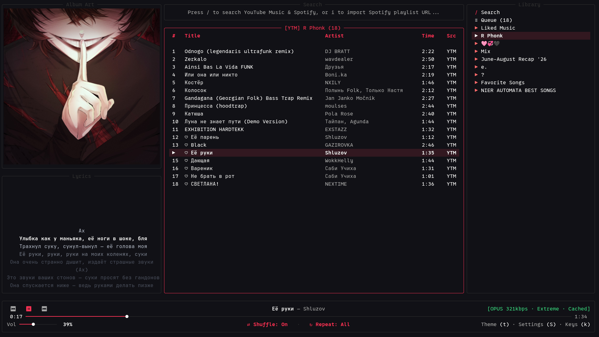
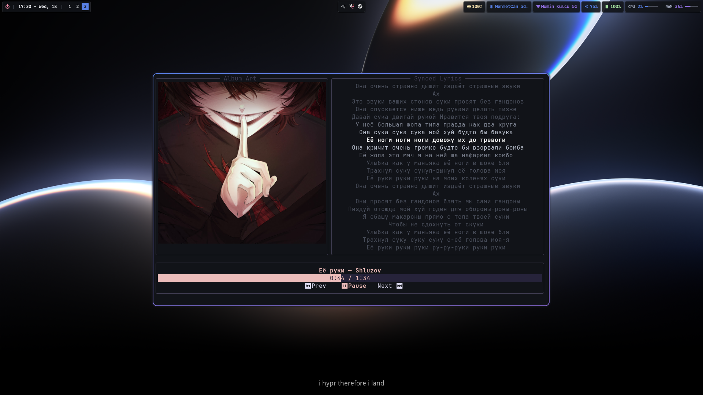

# Sonata

A fast, modular Rust music player workspace (**TUI + native Wayland/Hyprland GPUI Desktop**) for **YouTube Music** and **Spotify** with browser cookie authentication, fast playback with background Hi-Fi upgrades, HD album artwork, synced lyrics, a shared bounded cache, MPRIS2, and system tray background playback.



## One-Command TUI Install

Paste this complete script into a terminal. It installs TUI runtime dependencies, Rust, Sonata, and the `sonata` command. It does not build the desktop client.

```bash
set -euo pipefail

repo_url="https://github.com/MehmetCanWT/sonata.git"
source_dir="${SONATA_SOURCE_DIR:-${HOME}/.local/src/sonata}"

run_as_root() {
    if [ "$(id -u)" -eq 0 ]; then
        "$@"
    else
        sudo "$@"
    fi
}

if command -v pacman >/dev/null 2>&1; then
    run_as_root pacman -S --needed --noconfirm base-devel ca-certificates curl git mpv nodejs yt-dlp
elif command -v apt-get >/dev/null 2>&1; then
    run_as_root apt-get update
    run_as_root apt-get install -y build-essential ca-certificates curl git mpv nodejs yt-dlp
elif command -v dnf >/dev/null 2>&1; then
    run_as_root dnf install -y gcc gcc-c++ make ca-certificates curl git mpv nodejs yt-dlp
elif command -v brew >/dev/null 2>&1; then
    brew install mpv node yt-dlp git
else
    echo "Unsupported package manager. Install mpv, yt-dlp, nodejs, git, curl, and a C compiler first." >&2
    exit 1
fi

if ! command -v cargo >/dev/null 2>&1; then
    curl --proto '=https' --tlsv1.2 -sSf https://sh.rustup.rs | sh -s -- -y --profile minimal
fi

if [ -f "${HOME}/.cargo/env" ]; then
    . "${HOME}/.cargo/env"
fi

if ! command -v cargo >/dev/null 2>&1; then
    echo "Cargo is unavailable after Rust installation." >&2
    exit 1
fi

if [ -d "${source_dir}/.git" ]; then
    git -C "${source_dir}" pull --ff-only
elif [ -e "${source_dir}" ]; then
    echo "Install path exists and is not a Git checkout: ${source_dir}" >&2
    exit 1
else
    mkdir -p "$(dirname "${source_dir}")"
    git clone --depth=1 "${repo_url}" "${source_dir}"
fi

cd "${source_dir}"
export PATH="${HOME}/.local/bin:${HOME}/.cargo/bin:${PATH}"
cargo install --locked --path crates/sonata-tui --root "${HOME}/.local" --force

profile_file="${HOME}/.profile"
path_line='export PATH="$HOME/.local/bin:$HOME/.cargo/bin:$PATH"'
if ! grep -Fqx "${path_line}" "${profile_file}" 2>/dev/null; then
    printf '\n%s\n' "${path_line}" >> "${profile_file}"
fi

echo
echo "Sonata TUI installed: ${HOME}/.local/bin/sonata"
echo "Run it with: sonata"
```

## Workspace Architecture

Sonata is organized as a unified Cargo workspace so both terminal and desktop clients share the exact same streaming, caching, auth, lyrics, and audio core:

- `crates/sonata-core` — Shared Rust engine for auth, providers, playback, lyrics, themes, database, and media cache.
- `crates/sonata-tui` — **`sonata`** Ratatui terminal client with Kitty/Sixel/Halfblock album art and mouse-resizable panes.
- `crates/sonata-desktop` — **`sonata-desktop`** GPU-accelerated native Wayland GUI built with **GPUI** (`gpui-kit`).
- `crates/sonata-android` — Android client placeholder. Android implementation starts after TUI and desktop are stable.

Each client builds independently with its shared core dependency. Use `cargo build-tui` or `cargo build-desktop` while working on one client; changes in the other client will not be compiled. Both clients read the same settings, SQLite database, artwork, audio, and lyrics cache paths.

## Screenshots (TUI)

| Hyprland Glass Transparency | Mini Mode (Art + Lyrics) | Compact Mini Player |
|---|---|---|
|  |  |  |

## Desktop GUI (`sonata-desktop`)

- **YouTube Music Home & Public Feed**: Launches directly into a music discovery home with Trending tracks, New Albums & Singles, and Community Playlists even before signing in; signing in unlocks personalized mixes, Liked Music, and library playlists.
- **Explicit Browser Sign-In & Profile Menu**: Click **Sign In** (top-right) to choose which installed browser (Zen, Firefox, Brave, Chrome, etc.) Sonata reads YouTube Music cookies from; once signed in, the top-right shows your YouTube Music avatar, display name, and account menu (`Account & Settings`, `Switch Browser`, `Refresh Library`, `Sign Out`).
- **Dedicated Search, Playlist & Settings Views**: Dedicated YouTube Music search page with genre quick pills, virtualized track tables with 40×40 cover thumbnails, two-way YTM playlist management, and a full **Settings** page (including a `Link Spotify` preview placeholder).
- **Modern Glass & Dynamic Ambient Glow**: Translucent Wayland surfaces tinted in real time from the active track's album cover (`WindowBackgroundAppearance::Blurred`) with synchronized Hyprland opacity controls (`50%`–`100%`) and shared color themes (`Catppuccin Mocha`, `Ghostty Dark`, `Tokyo Night`, `Gruvbox Dark`, `Rosé Pine`, `Nord`, plus `~/.config/sonata/themes/*.toml`).
- **Focused Apple Music-Style Lyrics View**: Click the Lyrics icon (`Ctrl+L`) or player bar album cover for large rounded artwork, glowing auto-scrolled synced lyrics, and **click-to-seek** on any timestamped lyric line.
- **Compact Mini Player (`Ctrl+M`)**: Resizes cleanly into a draggable floating glass Mini Player card with optional live synced lyric line.
- **MPRIS2 (`org.mpris.MediaPlayer2.sonata`)**: Native media controls, metadata, artwork URI, seek, volume, shuffle, and repeat for Waybar, Hyprlock, `playerctl`, and hardware media keys.
- **System Tray & Background Playback**: Built-in StatusNotifierItem tray menu (`Show / Hide Window`, `Play / Pause`, `Next Track`, `Previous Track`, `Quit`). Closing the window hides it to the tray while audio continues playing; `Quit` cleanly stops `mpv`, removes `now_playing.json`, restores Hyprland opacity, and saves `config.toml`.

### Desktop Shortcuts

| Shortcut | Action |
|---|---|
| `Ctrl+F` | Focus search bar |
| `Space` | Play / Pause (when search/modals are unfocused) |
| `Left` / `Right` | Seek -5s / +5s |
| `Ctrl+L` | Switch between Library and Lyrics views |
| `Ctrl+M` | Toggle compact Mini Player mode |
| `Ctrl+,` | Open Settings & Theme selector |
| `Esc` | Close modal / Queue drawer / exit Mini Player |
| `Ctrl+Q` | Quit application cleanly (terminates background audio) |

### Optional Hyprland Blur Rule

GPUI renders translucent RGBA surfaces natively over Wayland; enabling blur on Hyprland gives the frosted glass look behind `sonata-desktop`:

```ini
windowrule = match:class ^(sonata-desktop)$, blur on
windowrule = match:class ^(sonata-desktop)$, ignore_alpha 0.25
```

Or if using `hyprland.lua`:

```lua
hl.window_rule({ match = { class = "^(sonata-desktop)$" }, blur = true, ignore_alpha = 0.25 })
```

## Shared Engine Highlights

- **Zero-Config Browser Auth**: Automatically extracts session cookies from Zen Browser, Firefox, LibreWolf, Floorp, Chrome, Chromium, Brave, Vivaldi, and Edge.
- **YouTube Music & Spotify (No API Keys)**:
  - Two-way YouTube Music library sync: browse playlists and Liked Music, like/unlike tracks, add/remove tracks, and create playlists.
  - Keyless Spotify library loading (`sp_dc`) and instant public Spotify playlist URL import.
  - Switch active providers anytime in Settings: **Both (YTM + Spotify)**, **YouTube Music Only**, or **Spotify Only**.
- **Instant Playback + Background Hi-Fi Upgrade**:
  - Starts streaming immediately via YouTube Music (`yt-dlp`), then upgrades seamlessly via FIFO `mpv` IPC (`loadfile` native `start` timestamp resume) to 320kbps AAC (JioSaavn bit-exact match) without interrupting playback, with automatic retry on expired stream URLs.
  - Consistent Shuffle lookahead & playback history, persisted Shuffle/Repeat/Volume settings, and live-switchable `mpv` audio DSP presets: `Hi-Res Crystal` (SoXR 96kHz + Crystalizer + Stereo + Limiter), `Spatial Wide`, `Warm Bass`, and `Bit-Perfect`.
- **Shared Cache & Hi-Res Prefetch**:
  - The TUI and desktop share artwork, audio, lyrics, and SQLite cache under `~/.cache/sonata/`.
  - Media cache defaults to 1 GB and can be set from Off to 10 GB in either client's Settings. Off clears saved cache data and disables cache-dependent Hi-Fi staging; it is not recommended.
  - SQLite uses WAL, schema versioning, expired-stream cleanup, and a bounded database size. Playlist and stream cache entries have count and size limits.
  - Upcoming audio is downloaded atomically and evicted by least-recent access when the configured media cache limit is exceeded.
- **Real-Time Synced Lyrics**:
  - Multi-source fetcher (LRCLIB, KuGou, YouTube Music native, Genius) with strict title/artist/duration match validation, local caching, and synced active-line tracking.

## TUI Keybindings & Mouse (`sonata`)

| Key / Input | Action |
|---|---|
| `Tab` / `h` / `l` | Switch between Sidebar and Track List |
| `↑` / `↓` / `j` / `g` / `G` | Navigate lists |
| `H` / `L` | Resize focused pane width |
| `/` | Search YouTube Music & Spotify |
| `Enter` | Open playlist / Play selected track |
| `Space` | Play / Pause |
| `n` / `p` | Next / Previous track (follows Shuffle history) |
| `<` / `>` | Seek -5s / +5s |
| `-` / `+` | Volume down / up |
| `e` | Cycle Audio Enhancer DSP preset |
| `s` / `r` | Toggle Shuffle / Cycle Repeat (`Off` / `All` / `One`) |
| `y` | Like / Unlike track on YouTube Music |
| `a` / `x` (`Delete`) | Add to / Remove from YouTube Music playlist |
| `c` / `R` | Create YouTube Music playlist / Refresh account & cache |
| `i` | Import Spotify playlist URL or ID |
| `m` / Double-Click Art | Toggle Mini Mode |
| `S` | Open Settings (Providers, Hi-Fi, DSP, Transparency, Hyprland Opacity, Theme) |
| `t` | Open Theme Picker (live preview) |
| `k` / `?` | Open / Close Keybindings menu |
| `q` / `Ctrl+C` | Quit |

**Mouse**: Drag panel borders or the Album Art/Lyrics divider to resize; click or drag the `0–100%` volume slider and progress bar; click tracks/playlists/controls; double-click Album Art for Mini Mode; scroll lists, player bar volume, and inside Theme/Settings/Playlist modals.

## Custom Themes & Shared Config

Create a `.toml` file under `~/.config/sonata/themes/my-theme.toml` (shared by both TUI and Desktop):

```toml
transparent_bg = true
hyprland_opacity = 0.90

[colors]
bg = "#14161b"
surface = "#1a1d24"
fg = "#e6edf3"
muted = "#7d8590"
accent = "#79c0ff"
border = "#30363d"
highlight_bg = "#21262d"
highlight_fg = "#ffffff"
lyrics_active = "#79c0ff"
lyrics_inactive = "#6e7681"
success = "#56d364"
warning = "#e3b341"
error = "#f85149"
```

Global settings are stored in `~/.config/sonata/config.toml` and can also be edited live inside Settings in either client. The media cache limit applies to both clients.

## Logs

Both clients write runtime logs to `~/.cache/sonata/sonata.log`. Follow playback resolution, retries, quality upgrades, and failures with:

```bash
tail -f ~/.cache/sonata/sonata.log
```

Set `RUST_LOG=debug` before starting a client for resolver and mpv details. The log is limited to 10 MiB at startup and uses user-only permissions on Unix.

## External Integrations (`now_playing.json`)

Both `sonata` and `sonata-desktop` atomically export live playback state to `$XDG_RUNTIME_DIR/sonata/now_playing.json` (fallback: `~/.cache/sonata/now_playing.json`) for Waybar, Hyprlock, Eww, or custom scripts (`status`, `title`, `artist`, `album`, `source`, `quality`, `position_secs`, `duration_secs`, `position`, `duration`, `lyric`, `art_path`, `art_url`, `updated_at`), and remove the file on clean exit. `sonata-desktop` additionally exposes full MPRIS2 control over D-Bus.

## Requirements

- `mpv` (audio playback & DSP filters)
- `yt-dlp` and `nodejs` (stream resolution)
- A terminal with Kitty Graphics Protocol support (such as **Ghostty**, **Kitty**, or **WezTerm**) for HD album art in `sonata`
- Wayland + Vulkan/OpenGL drivers for `sonata-desktop`

## Installation

### TUI Only

Install the terminal client without building the desktop application:

Requirements:

- Rust stable and Cargo
- `mpv` for audio playback
- `yt-dlp` for stream resolution
- `nodejs` optional, for enhanced YouTube extraction support
- Kitty, Ghostty, or WezTerm optional, for full-color album artwork

From a source checkout:

```bash
git clone https://github.com/MehmetCanWT/sonata.git
cd sonata
cargo build --locked --release -p sonata-tui
install -Dm755 target/release/sonata ~/.local/bin/sonata
```

One-line install from the repository root:

```bash
cargo install --locked --path crates/sonata-tui
```

Start Sonata:

```bash
sonata
```

For local development without installing the binary:

```bash
cargo run --locked -p sonata-tui
```

The TUI reads browser cookies from supported browsers for YouTube Music sign-in. Shared settings, artwork, audio, lyrics, and SQLite data are stored under `~/.config/sonata/` and `~/.cache/sonata/`.

### Build One Client

```bash
cargo check-tui
cargo build-tui

cargo check-desktop
cargo build-desktop
```

Each target shares the incremental `sonata-core` build while leaving the other client out of the build.

### Install from Source

```bash
cargo build --release -p sonata-tui
cargo build --release -p sonata-desktop
install -Dm755 target/release/sonata ~/.local/bin/sonata
install -Dm755 target/release/sonata-desktop ~/.local/bin/sonata-desktop
install -Dm644 assets/sonata-desktop.desktop ~/.local/share/applications/sonata-desktop.desktop
```

### Arch / CachyOS

Build and install only the terminal client:

```bash
makepkg -si
```

Build and install only the desktop client:

```bash
makepkg -p PKGBUILD.desktop -si
```
