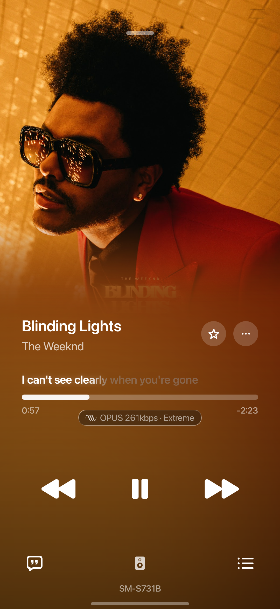
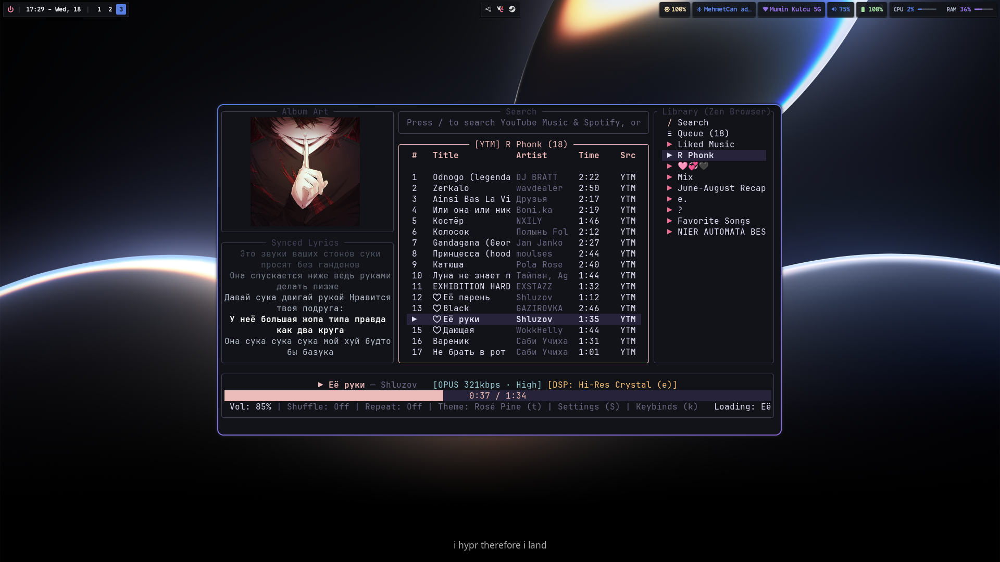
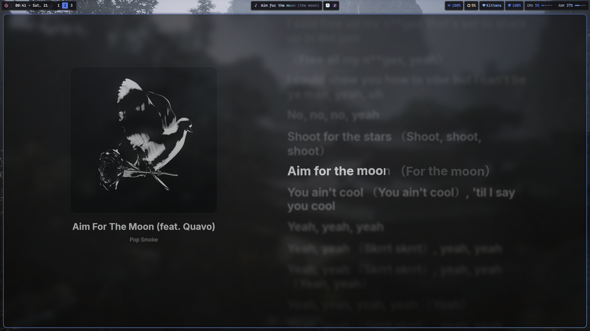
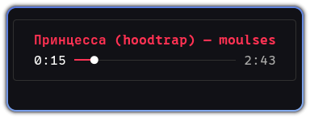

<div align="center">
  
  <h1>Sonata</h1>
  <p><strong>A fast, modular Rust music player ecosystem for Linux Terminal, Wayland Desktop, and Android (Mobile &amp; Tablet).</strong></p>
  <p>
    <a href="https://github.com/MehmetCanWT/sonata/releases/latest"></a>
    <a href="https://github.com/MehmetCanWT/sonata/actions/workflows/release-builds.yml"></a>
    
    <a href="LICENSE"></a>
  </p>
</div>

---

Sonata pairs a single shared Rust core (`sonata-core`) with three native clients for **YouTube Music** and **Spotify**: native **`itag=774` (~256–321 kbps Opus Extreme)** and **`itag=141` (256 kbps AAC Extreme)** playback, word-by-word & duet Apple Music TTML karaoke lyrics (`lrc.red`, BetterLyrics, LyricsPlus, LRCLIB), 24 fps animated Apple Music motion covers, bounded SQLite WAL caching, MPRIS2, System Tray, `now_playing.json` telemetry, and automatic in-app update notifications.

| Client | Platform | Stack | Distribution |
|---|---|---|---|
| **`sonata`** | Linux / macOS Terminal | Ratatui + Kitty/Sixel Art | One-line installer, AUR (`PKGBUILD`), Cargo |
| **`sonata-desktop`** | Linux Wayland / Hyprland | GPUI (`gpui-kit`) + `mpv` | GitHub Releases **AppImage**, AUR (`PKGBUILD.desktop`), One-line installer |
| **`Sonata`** | Android 8.0+ (Phone & Tablet) | Jetpack Compose + Media3 + UniFFI | GitHub Releases **APK (`arm64-v8a`)** |

---

## Screenshots

### Android — Now Playing & Synced Karaoke Lyrics

<div align="center">
  <table>
    <tr>
      <th>Now Playing</th>
      <th>Word-Synced Karaoke Lyrics</th>
    </tr>
    <tr>
      <td align="center">
        
      </td>
      <td align="center">
        
      </td>
    </tr>
  </table>
</div>

### Desktop & Terminal UI


| Hyprland Glass Transparency | Hyprland Glass Desktop | Mini Mode (Art + Lyrics) | Compact Mini Player |
|---|---|---|---|
|  |  |  |  |

---

## Installation

### 1. Android APK (Mobile & Tablet)

Download the latest **`Sonata-v1.0.0-arm64.apk`** directly from [GitHub Releases](https://github.com/MehmetCanWT/sonata/releases/latest) and install it on any `arm64-v8a` Android 8.0+ phone or tablet.

### 2. Linux Desktop GUI (`sonata-desktop`)

#### Prebuilt AppImage (Recommended — No Compilation Needed)

Download **`Sonata-v1.0.0-x86_64.AppImage`** from [GitHub Releases](https://github.com/MehmetCanWT/sonata/releases/latest):

```sh
chmod +x Sonata-v1.0.0-x86_64.AppImage
./Sonata-v1.0.0-x86_64.AppImage

# Tip: the same AppImage also bundles the TUI client:
./Sonata-v1.0.0-x86_64.AppImage --tui
```

#### Arch Linux / AUR (`PKGBUILD.desktop`)

```sh
makepkg -p PKGBUILD.desktop -si
```

#### One-Line Source Installer

```sh
curl -fsSL https://raw.githubusercontent.com/MehmetCanWT/sonata/main/install-desktop.sh | sh
```

### 3. Terminal UI (`sonata`)

#### One-Line Installer (No Clone Required)

```sh
curl -fsSL https://raw.githubusercontent.com/MehmetCanWT/sonata/main/install.sh | sh
```

#### Arch Linux / AUR (`PKGBUILD`)

```sh
makepkg -si
```

#### Direct Cargo Install

```sh
cargo install --git https://github.com/MehmetCanWT/sonata.git --locked sonata-tui
```

> [!TIP]
> [`install.sh`](install.sh) and [`install-desktop.sh`](install-desktop.sh) automatically install required runtime tools (`mpv`, `yt-dlp`, `ffmpeg`, `nodejs`, plus Wayland/Vulkan/XKB/ALSA/D-Bus libraries for Desktop) via `pacman`, `apt-get`, `dnf`, `zypper`, or `brew`, install Rust via `rustup` if missing, compile while leaving 2 CPU threads free, and register the desktop icon & launcher.

---

## Core Highlights

- **Native Extreme Audio (`itag=774` / `itag=141`)**:
  - Authenticated `TVHTML5` InnerTube client + zero-AST `base.js` JS cipher solver unlocks YouTube Music Premium **`itag=774` (~256–321 kbps Opus Extreme)** and **`itag=141` (256 kbps AAC Extreme)** natively across Android (offscreen V8 WebView bridge), Desktop, and TUI.
  - Fast-start playback with seamless background Hi-Fi upgrades, lookahead precaching, consistent Shuffle history, and live-switchable `mpv` DSP presets (`Hi-Res Crystal`, `Spatial Wide`, `Warm Bass`, `Bit-Perfect`).
- **Word-Synced & Duet Karaoke Lyrics**:
  - Multi-source concurrent resolution prioritized by timing accuracy: **`lrc.red`** (ISRC-keyed Apple Music TTML), **BetterLyrics**, **LyricsPlus v2**, **LRCLIB**, **KuGou KRC**, **NetEase YRC**, **QQ Music**, and native YouTube Music/Genius fallbacks.
  - Strict recording-version isolation (`Extended`, `Remix`, `Slowed`, `Sped Up`, `Live`, `Acoustic`) and tight `<= 3.5s` duration matching prevent mismatched edits from ever polluting the cache.
  - Duet `Lead` / `Counter` left-right alignment, background vocal styling, 3-dot instrumental break indicators, and a steered monotonic frame clock that glides smoothly without buffering drift.
- **Adaptive Android Phone & Tablet Experience**:
  - Full-bleed edge-to-edge hero Now Playing in portrait; spacious two-column Now Playing in tablet landscape with elevated square artwork, persistent media controls, tap-artwork Lyrics toggle, and multi-column Explore/Library grids.
  - Built-in YouTube Music web sign-in, Media3 foreground playback service, Bluetooth/notification media controls, and 60/120 Hz frame-rate option.
- **Native Wayland / Hyprland Desktop (`sonata-desktop`)**:
  - Live-switchable **Sonata Glass**, **Spotify**, and **YouTube Music** skins, personalized multi-page YouTube Music Home feed, 24 fps Apple Music animated Motion Covers, fullscreen ambient wave shaders, 3-tier Mini Player (`Ctrl+M`), MPRIS2, and System Tray.
- **Built-In Update Notifications**:
  - Desktop (`sonata-desktop`), TUI (`sonata`), and Android automatically check GitHub Releases on startup and alert you when a newer version is published (header pill + clickable **Download Update** button in Desktop Settings, `[Update vX.Y.Z]` player badge & status alert in TUI, and Settings check on Android).
- **Zero-Config Browser Auth & Two-Way Sync**:
  - Automatically extracts session cookies from Zen Browser, Firefox, LibreWolf, Floorp, Chrome, Chromium, Brave, Vivaldi, and Edge with `0o600` atomic storage.
  - Two-way YouTube Music library sync (playlists, Liked Music, like/unlike, add/remove, create playlists) plus keyless Spotify (`sp_dc`) library loading and public playlist URL import.
- **Shared Bounded Cache & External Telemetry**:
  - Shared SQLite WAL database (`PRAGMA user_version = 3`) and configurable LRU media cache (`Off` to `10 GB`, default `1 GB`) under `~/.cache/sonata/`.
  - Atomic `$XDG_RUNTIME_DIR/sonata/now_playing.json` export for Waybar, Hyprlock, Eww, and custom scripts.

---

## Versioning & Automated Releases

Sonata follows [Semantic Versioning](https://semver.org/) starting at **`v1.0.0`**:

- **Unified Version Source**: Rust workspace crates (`Cargo.toml`), Arch `PKGBUILD` / `PKGBUILD.desktop`, Android `versionName`, and GitHub Release tags share the same `MAJOR.MINOR.PATCH` version. Android `versionCode` is derived deterministically as `MAJOR * 10000 + MINOR * 100 + PATCH` (`1.0.0` → `10000`).
- **Automated CI Releases**: Pushing a tag such as `v1.0.0` runs [`.github/workflows/release-builds.yml`](.github/workflows/release-builds.yml), which automatically builds and publishes:
  - `Sonata-v<version>-x86_64.AppImage` (Linux Desktop GUI + bundled `--tui` mode)
  - `Sonata-v<version>-arm64.apk` (Installable Android `arm64-v8a` APK)
  - `SHA256SUMS.txt` (Integrity checksums for all assets)

---

## Workspace Architecture

Sonata is organized as a 4-crate Cargo workspace + native Android Compose app:

- `crates/sonata-core` — Shared Rust engine (browser auth, YouTube Music & Spotify providers, `TVHTML5` + `base.js` cipher solver, `mpv` IPC playback, multi-source TTML/KRC/YRC/LRCLIB lyrics, animated motion covers, themes, SQLite WAL cache, and GitHub Releases updater).
- `crates/sonata-tui` — **`sonata`**: Ratatui terminal client with Kitty/Sixel/Halfblock album art, mouse-resizable panes, synced lyrics, Mini Mode, and update notifications.
- `crates/sonata-desktop` — **`sonata-desktop`**: Native Wayland/Hyprland GPUI desktop client with selectable skins, fullscreen lyrics, Mini Player, MPRIS2, System Tray, and update notifications.
- `crates/sonata-android` + `android/` — **`Sonata` (Android)**: UniFFI Rust bridge (`libsonata_android.so`) + Jetpack Compose / Media3 ExoPlayer mobile and tablet application.

---

## TUI Keybindings & Mouse (`sonata`)

| Key / Input | Action |
|---|---|
| `Tab` / `h` / `l` | Switch between Sidebar and Track List |
| `↑` / `↓` / `j` / `g` / `G` | Navigate lists |
| `H` / `L` | Resize focused pane width |
| `/` | Search YouTube Music & Spotify |
| `Enter` | Open playlist / Play selected track |
| `Space` | Play / Pause |
| `n` / `p` | Next / Previous track (follows Shuffle history) |
| `<` / `>` (or `,` / `.`) | Seek -5s / +5s |
| `-` / `+` (or `_` / `=`) | Volume down / up |
| `e` | Cycle Audio Enhancer DSP preset |
| `s` / `r` | Toggle Shuffle / Cycle Repeat (`Off` / `All` / `One`) |
| `y` | Like / Unlike track on YouTube Music |
| `a` / `x` (`Delete`) | Add to / Remove from YouTube Music playlist |
| `c` / `R` | Create YouTube Music playlist / Refresh account & cache |
| `i` | Import Spotify playlist URL or ID |
| `m` / Double-Click Art | Toggle Mini Mode |
| `S` | Open Settings (Providers, Hi-Fi, DSP, Transparency, Opacity, Theme, Updates) |
| `u` | Check GitHub Releases for updates (inside Settings) |
| `t` | Open Theme Picker (live preview) |
| `k` / `?` | Open / Close Keybindings menu |
| `q` / `Ctrl+C` | Quit |

**Mouse**: Drag panel borders or the Album Art/Lyrics divider to resize; click or drag the `0–100%` volume slider and progress bar; click tracks/playlists/controls; double-click Album Art for Mini Mode; scroll lists, player bar volume, and inside modals.

## Desktop Shortcuts (`sonata-desktop`)

| Shortcut | Action |
|---|---|
| `Ctrl+F` | Focus search bar |
| `Space` | Play / Pause (when search/modals are unfocused) |
| `Left` / `Right` | Seek -5s / +5s |
| `Ctrl+L` | Switch between Library and Lyrics views |
| `Ctrl+M` | Toggle compact Mini Player mode |
| `Ctrl+,` | Open Settings, Skins & Updates |
| `Esc` | Close modal / Queue drawer / exit Mini Player |
| `Ctrl+Q` | Quit cleanly (terminates background audio) |

### Optional Hyprland Blur Rule

```ini
windowrule = match:class ^(sonata-desktop)$, blur on
windowrule = match:class ^(sonata-desktop)$, ignore_alpha 0.25
```

---

## Custom Themes, Logs & Integrations

- **Custom Themes**: Create `~/.config/sonata/themes/my-theme.toml` (shared by TUI and Desktop) and configure global options in `~/.config/sonata/config.toml`.
- **Logs**: Runtime logs live in `~/.cache/sonata/sonata.log` (capped at 10 MiB, `0o600` on Unix; set `RUST_LOG=debug` for verbose IPC/resolver logs).
- **External Integrations**: `$XDG_RUNTIME_DIR/sonata/now_playing.json` (fallback: `~/.cache/sonata/now_playing.json`) exports live track metadata, quality badge, active lyric, progress, and artwork path for Waybar, Hyprlock, and Eww.

## Building from Source

```sh
git clone https://github.com/MehmetCanWT/sonata.git
cd sonata

# Terminal client
cargo check-tui
cargo build --release -p sonata-tui

# Desktop GUI client
cargo check-desktop
cargo build --release -p sonata-desktop

# Android native library + APK (requires Android SDK/NDK 27 + cargo-ndk)
cargo ndk -t arm64-v8a -P 26 -o android/app/src/main/jniLibs build -p sonata-android --release
cd android && ./gradlew :app:assembleRelease
```

## Documentation

- [`docs/architecture.md`](docs/architecture.md) — Workspace crate map, threading & IPC model, and filesystem layout.
- [`docs/how-it-works.md`](docs/how-it-works.md) — Browser cookie auth, `TVHTML5`/cipher pipeline, synced lyrics, and visual effects.
- [`docs/android-research.md`](docs/android-research.md) — Android Jetpack Compose + UniFFI client architecture.
- [`PRIVACY.md`](PRIVACY.md) — Local-only cookie handling, direct provider requests, and cache/log policy.
- [`CONTRIBUTING.md`](CONTRIBUTING.md) & [`AGENTS.md`](AGENTS.md) — Contributor workflow and verification checks.
- [`CHANGELOG.md`](CHANGELOG.md) — Full SemVer release history starting from `1.0.0`.

## License

Licensed under the [MIT License](LICENSE).
