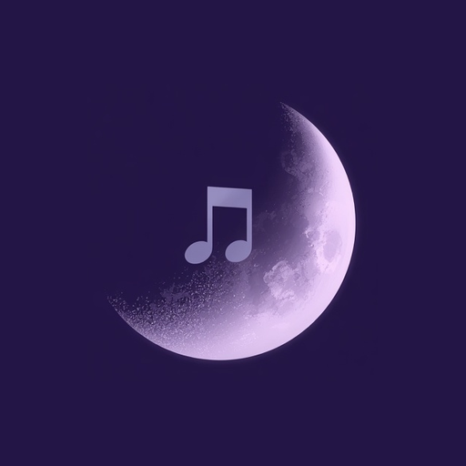
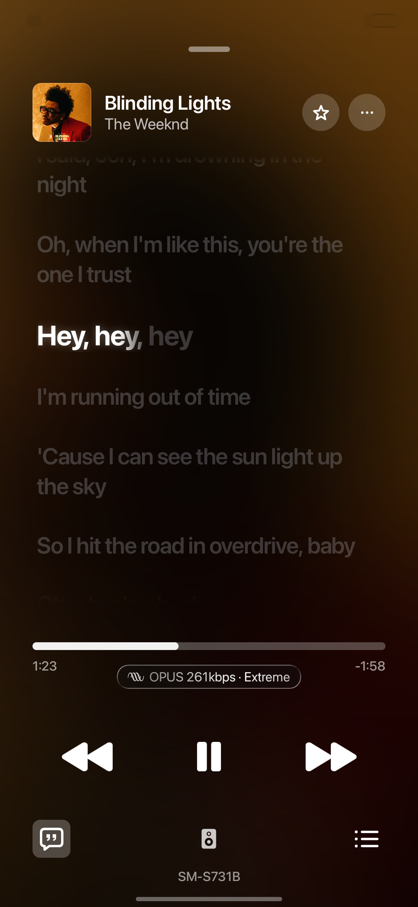

<div align="center">

<br/>



# Sonata

### Aesthetic Cross-Platform Music Player — Android, Linux Desktop & Terminal

<br/>

[](https://github.com/MehmetCanWT/sonata/releases/latest)
[](LICENSE)
[](https://github.com/MehmetCanWT/sonata/releases)
[](#architecture)

<br/>

[**Download**](#download) · [**Screenshots**](#screenshots) · [**Features**](#features) · [**Build from Source**](#build-from-source) · [**Privacy**](PRIVACY.md) · [**Disclaimer**](#disclaimer)

<br/>

</div>

> [!IMPORTANT]
> Sonata is an independent open-source music client and is not affiliated with, endorsed by, or connected to Google, YouTube Music, or Spotify in any way. Use it at your own discretion.

---

<div align="center">

<h1><a id="features"></a>Features</h1>

<table>
  <tr>
    <td width="50%" valign="top">

#### Playback & High-Fidelity Audio
- **Native Extreme Audio** — authenticated `TVHTML5` InnerTube client + zero-AST JS cipher unlocks **`itag=774` (~256–321 kbps Opus Extreme)** and **`itag=141` (256 kbps AAC Extreme)** across Android, Desktop, and Terminal.
- **Optional JioSaavn Module** — opt-in 320 kbps AAC source in *Settings → Modules* that searches in parallel and seamlessly upgrades playback when a strictly higher bitrate is found, while still attributing playback to YouTube Music.
- **Background Quality Upgrades (Online, Cached & Offline)** — cached and offline-downloaded tracks continue checking for higher-tier streams respecting your selected `AudioQualityTier` and seamlessly hot-swap at playback position.
- **Explicit Track Preference & Offline Library** — prefers explicit recordings over edited versions, saves permanent offline tracks/albums/playlists in **Downloads**, and auto-recovers mid-track stream drops.

#### Cross-Platform Ecosystem & Sync
- **Android (Phone & Tablet)** — native Jetpack Compose + Media3 ExoPlayer client backed by Rust (`sonata-core` via UniFFI), adaptive portrait/landscape layouts, home-screen widget, and **60 / 90 / 120 Hz** support.
- **Full YouTube Music Attribution & Listening History** — reports playback (`report_playback`), playlist edits, and likes across Android, Desktop, and Terminal so your YouTube Music Listening History and Annual Replay stay accurate, paired with an in-app **Listening History** page and live *Library → Artists* ranking.
- **Linux Wayland Desktop (`sonata-desktop`)** — native GPUI (`gpui-kit`) client with ambient wave shaders, selectable skins, MPRIS2, System Tray, and Waybar/Hyprlock telemetry.
- **Terminal Client (`sonata`)** — ultra-fast Ratatui TUI with Kitty/Sixel/Halfblock artwork, animated motion covers, word-synced lyrics, and Mini Mode.

    </td>
    <td width="50%" valign="top">

#### Dual Design Themes & Liquid Glass UI
- **Violet & Moonflower Themes (Light, Dark & AMOLED)** — two structurally distinct theme systems (`Violet` default + `System` appearance, or `Moonflower`) with unique backdrops, card shapes, dividers, full-bleed blurred Artist hero transitions, and **Pinkish Liquid Glass** active navigation domes (`GlassSelectionPill`).
- **Theme-Specific Artwork & 15 Mood Animations** — custom moon & floral PNG banners on Library summary cards, small crescent badges across *Top Picks* and *Find Your Mood*, and 15 distinct seamlessly looping motion artworks (`Feeling Blue`, `Heartbreak`, `Energy`, `Focus`, etc.).
- **Visual Share Cards (`SonataShareSheet`)** — artwork-palette and theme-matched preview cards tailored per Song, Album, Playlist, and Artist with one-tap **Share Link**, **Share Image**, and **Save Image** (`Pictures/Sonata`).
- **Animated Album Covers (Canvas) & Karaoke Lyrics** — Apple Music HLS / Tidal / Community Canvas videos plus multi-provider word-synced & dual-voice karaoke lyrics (`lrc.red` TTML, BetterLyrics, LyricsPlus, LRCLIB, KuGou, NetEase, QQ Music, YTM, Genius) with romanization, translation, and per-track timing offsets.

#### Controls, Privacy & Security
- **Audio Pipeline & Account Switching** — playback speed, loudness normalization, silence skip, equalizer presets, sleep timer, 4-stage Audio Pipeline modal, and clean one-tap WebView **Account Switching**.
- **Zero Trackers & 100% FOSS** — no ads, no analytics, no Firebase or Google Play Services, reproducible APKs (`dependenciesInfo` disabled, no `REQUEST_INSTALL_PACKAGES`), and `0o600`/`0o700` private credential handling ([PRIVACY.md](PRIVACY.md)).
- **Built-in Update Notifications** — GitHub Releases checks across Android (manual APK download handoff), Desktop, and Terminal.

    </td>
  </tr>
</table>

</div>

---

<div align="center">

<h1><a id="screenshots"></a>Screenshots</h1>

<table>
  <tr>
    <th colspan="2">Android — Now Playing &amp; Word-Synced Karaoke Lyrics</th>
  </tr>
  <tr>
    <td align="center" width="50%">
      
    </td>
    <td align="center" width="50%">
      
    </td>
  </tr>
  <tr>
    <th width="50%">Linux Wayland Desktop (<code>sonata-desktop</code>)</th>
    <th width="50%">Linux Terminal TUI (<code>sonata</code>)</th>
  </tr>
  <tr>
    <td align="center" width="50%">
      
    </td>
    <td align="center" width="50%">
      
    </td>
  </tr>
</table>

</div>

---

<div align="center">

<h1><a id="download"></a>Download</h1>

<a href="https://github.com/MehmetCanWT/sonata/releases/latest" target="_blank" rel="noopener noreferrer"></a>
<a href="https://github.com/MehmetCanWT/sonata/releases/latest" target="_blank" rel="noopener noreferrer"></a>

<br/><br/>

<table>
  <tr>
    <td width="50%" valign="top">

#### Android (Mobile & Tablet, `arm64-v8a`)
- **Obtainium (Auto-Updates):** Add `https://github.com/MehmetCanWT/sonata` with APK filter `Sonata-.*-arm64\.apk$`.
- **Direct APK:** Grab the latest signed **`Sonata-v1.0.2-arm64.apk`** from [GitHub Releases](https://github.com/MehmetCanWT/sonata/releases/latest).

    </td>
    <td width="50%" valign="top">

#### Linux Desktop & Terminal (`x86_64`)
- **AppImage (GUI + TUI):** Download **`Sonata-v1.0.2-x86_64.AppImage`** from [GitHub Releases](https://github.com/MehmetCanWT/sonata/releases/latest), `chmod +x`, and run (`--tui` launches the terminal client).
- **One-Line Installer:**
  ```sh
  # Terminal client (sonata)
  curl -fsSL https://raw.githubusercontent.com/MehmetCanWT/sonata/main/install.sh | sh

  # Desktop GUI (sonata-desktop)
  curl -fsSL https://raw.githubusercontent.com/MehmetCanWT/sonata/main/install-desktop.sh | sh
  ```
- **Arch Linux / AUR:** `makepkg -si` (`PKGBUILD` for TUI, `PKGBUILD.desktop` for Desktop).

    </td>
  </tr>
</table>

</div>

---

<a id="architecture"></a>
<a id="build-from-source"></a>

<details>
<summary><strong>Architecture &amp; Build from Source</strong></summary>

### Workspace Layout

| Crate / Folder | Role |
|---|---|
| `crates/sonata-core` | Shared Rust engine (auth, Hi-Fi cipher & stream resolution, YTM playback reporting, multi-provider TTML/YRC/KRC/LRCLIB lyrics, SQLite WAL cache, `mpv` IPC, updater) |
| `crates/sonata-android` + `android/` | UniFFI Rust bridge (`libsonata_android.so`) + modular Jetpack Compose / Media3 ExoPlayer Android app (`Violet` & `Moonflower` themes, Liquid Glass, Share Sheet, Widget) |
| `crates/sonata-desktop` | Native GPUI Wayland/Hyprland desktop client with ambient shaders, MPRIS2 & system tray |
| `crates/sonata-tui` | Ratatui terminal client with Kitty/Sixel/Halfblock artwork & word-synced lyrics |

### Build Commands

```sh
# Rust workspace (Linux Desktop & TUI)
cargo build --release --locked -p sonata-tui -p sonata-desktop

# Android native library + release APK (JDK 21, Android SDK 35, NDK 27.2.12479018, cargo-ndk)
rustup target add aarch64-linux-android
cargo ndk -t arm64-v8a -P 26 -o android/app/src/main/jniLibs build -p sonata-android --release --locked
cd android && ./gradlew :app:assembleRelease --console=plain
```

### Verification Suite

```sh
cargo fmt --all -- --check
cargo clippy --workspace --all-targets --all-features --locked -- -D warnings
cargo test --offline -p sonata-core -p sonata-desktop -p sonata-tui -p sonata-android
cd android && ./gradlew testDebugUnitTest --console=plain
```

</details>

---

<div align="center">

<h1><a id="disclaimer"></a>Disclaimer & Legal Notice</h1>

Sonata is an independent, community-driven third-party audio player and client. It is **not** associated with Google LLC, YouTube Music, Spotify AB, JioSaavn, or any of their parent companies.

- **No Media Hosting:** Sonata does not host, upload, or distribute copyrighted music files. It operates strictly as a client interface for local playback or streaming from public and user-authenticated APIs.
- **Fair Use & Responsibility:** This software is provided for personal, educational, and fair-use purposes. Users are solely responsible for complying with local copyright laws and third-party platform Terms of Service.
- **Privacy:** All session cookies and caches are stored locally on your device with restricted permissions (`0o600`/`0o700`) and are never transmitted to any third-party telemetry server. See [PRIVACY.md](PRIVACY.md).

</div>

---

<div align="center">

<h1><a id="license"></a>License</h1>

This project is licensed under the **MIT License**. See the [LICENSE](LICENSE) file for details.

</div>
