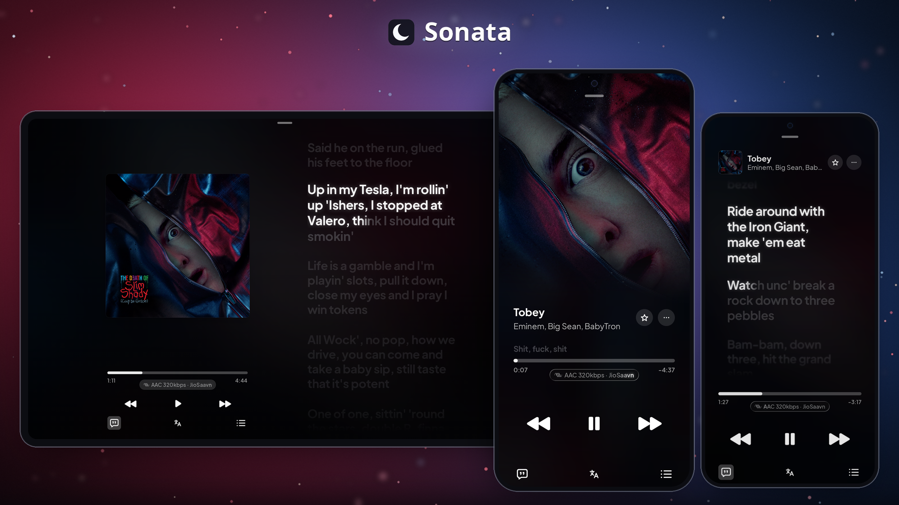

<div align="center">



<br/><br/>

[](https://github.com/MehmetCanWT/sonata/releases/latest)
[](LICENSE)
[](https://github.com/MehmetCanWT/sonata/releases)
[](#architecture)

<br/>

<a href="https://github.com/MehmetCanWT/sonata/releases/latest" target="_blank" rel="noopener noreferrer"></a>

<br/><br/>

### Aesthetic Cross-Platform Music Player — Android, Linux Desktop &amp; Terminal

[**Download**](#download) · [**Screenshots**](#screenshots) · [**Features**](#features) · [**Local &amp; Cloud Sources**](docs/local-and-cloud-sources.md) · [**Docs**](#documentation) · [**Build from Source**](#build-from-source) · [**Privacy**](PRIVACY.md) · [**Disclaimer**](#disclaimer)

<br/>

</div>

> [!IMPORTANT]
> Sonata is an independent open-source music client and is not affiliated with, endorsed by, or connected to Google, YouTube Music, or Spotify in any way. Use it at your own discretion.

---

<div align="center">

<h1><a id="features"></a>Features</h1>

<table>
  <tr>
    <td width="50%" valign="top">

#### Playback &amp; High-Fidelity Audio
- **Native Extreme Audio** — authenticated `TVHTML5` InnerTube client + zero-AST JS cipher unlocks **`itag=774` (~256–321 kbps Opus Extreme)** and **`itag=141` (256 kbps AAC Extreme)** across Android, Desktop, and Terminal.
- **Optional JioSaavn Module** — opt-in 320 kbps AAC source in *Settings → Audio Quality* that searches in parallel and seamlessly hot-swaps playback when a strictly higher bitrate is found, while still attributing playback to YouTube Music.
- **Background Quality Upgrades (Online, Cached &amp; Offline)** — cached and offline-downloaded tracks continue checking for higher-tier streams respecting your selected quality tier and upgrade seamlessly at playback position.
- **Explicit Preference &amp; Offline Downloads** — prefers explicit recordings over edited versions, supports configurable download quality tiers (`Highest` to `Data Saver`) with internal/external storage selection, and auto-recovers mid-track stream drops.

#### Cross-Platform Ecosystem &amp; Sync
- **Android (Phone &amp; Tablet)** — native Jetpack Compose + Media3 ExoPlayer client backed by async Rust (`sonata-core` via UniFFI), adaptive portrait/landscape split layouts, home-screen widget, and **60 / 90 / 120 Hz** support.
- **Full YouTube Music Attribution, Playlist Editing & Sync** — reports playback (`report_playback`), playlist metadata &amp; custom cover uploads, and likes across Android, Desktop, and Terminal so Listening History and Replay stay accurate, paired with an in-app **Listening History** view.
- **Linux Wayland Desktop (`sonata-desktop`)** — native GPUI (`gpui-kit`) client with compositor blur, 29 live-reloading CSS skins, dual-hue ambient wave shaders, 60 FPS subpixel karaoke lyrics, background audio-only freeze + low-power mini mode, MPRIS2, System Tray, and `en`/`tr`/`ru` UI localization.
- **Terminal Client (`sonata`)** — ultra-fast Ratatui TUI with Kitty/Sixel/Halfblock artwork, animated motion covers, 60 FPS character-by-character lyrics with `tachyonfx` transitions, `en`/`tr`/`ru` localization, and responsive Mini Mode.

    </td>
    <td width="50%" valign="top">

#### Design Themes &amp; Crystal-Clear Liquid Glass
- **Basic, Violet &amp; Moonflower Themes (Light, Dark &amp; AMOLED)** — starts cleanly on the monochrome editorial **Basic** theme (`System` appearance), with full **Violet** and **Moonflower** atmospheric themes available anytime, unified under neutral crystal-clear **Liquid Glass** floating chrome.
- **Theme-Specific Artwork &amp; 15 Mood Animations** — duotone mood sleeves in Basic, custom moon &amp; floral artwork across Violet and Moonflower, and 15 seamlessly looping animated mood covers (*Feeling Blue*, *Heartbreak*, *Energy*, *Focus*, and more).
- **Visual Share Cards (`SonataShareSheet`)** — artwork-palette and theme-matched preview cards tailored per Song, Album, Playlist, and Artist with one-tap **Share Link**, **Share Image**, and **Save Image** (`Pictures/Sonata`).
- **Animated Album Covers (Canvas) &amp; Word-Synced Lyrics** — Apple Music HLS / Tidal / Community Canvas motion covers plus multi-provider word-synced &amp; dual-voice karaoke lyrics (`lrc.red` TTML, BetterLyrics, LyricsPlus, LRCLIB, KuGou, NetEase, QQ Music, YTM, Genius) with live translation, romanization, and per-track timing offsets.

#### Controls, Privacy &amp; Security
- **Categorized Settings &amp; Audio Pipeline** — searchable 9-category settings menu, playback speed, silence skip, sleep timer with fade-out, 4-stage Audio Pipeline inspector, multilingual UI (`English`, `Turkish`, `Russian` — following system locale on Android), and one-tap WebView **Account Switching**.
- **Zero Trackers &amp; 100% FOSS** — no ads, no analytics, no Firebase or Google Play Services, reproducible APKs (`dependenciesInfo` disabled; `REQUEST_INSTALL_PACKAGES` used solely for user-initiated GitHub Releases APK updates), and `0o600`/`0o700` private credential handling ([PRIVACY.md](PRIVACY.md)).
- **Local &amp; Self-Hosted Sources + Personal Only Mode** — browse and stream directly from **Local Music** folders (with junk exclusion &amp; SAF folder picker), **Jellyfin**, **Subsonic / Navidrome**, **WebDAV**, and **SMB2/SMB3** (`smbj`) shares with embedded FLAC tags, `artist.json`/`artist.nfo`, folder cover art, sidecar `.lrc` lyrics, live `kbps` quality telemetry, and full offline/personal network isolation ([docs/local-and-cloud-sources.md](docs/local-and-cloud-sources.md)).
- **Built-in Updates** — GitHub Releases update alerts across Android, Desktop, and Terminal, plus in-app arm64 APK auto-download &amp; `PackageInstaller` launch on Android.

    </td>
  </tr>
</table>

</div>

---

<div align="center">

<h1><a id="screenshots"></a>Desktop &amp; Terminal Screenshots</h1>

<table>
  <tr>
    <th width="50%">Linux Wayland Desktop (<code>sonata-desktop</code>)</th>
    <th width="50%">Linux Terminal TUI (<code>sonata</code>)</th>
  </tr>
  <tr>
    <td align="center" width="50%">
      
    </td>
    <td align="center" width="50%">
      
    </td>
  </tr>
</table>

</div>

---

<div align="center">

<h1><a id="download"></a>Download</h1>

<table>
  <tr>
    <td width="50%" valign="top">

#### Android (Mobile &amp; Tablet, `arm64-v8a`)
- **Obtainium (Auto-Updates):** Add `https://github.com/MehmetCanWT/sonata` with APK filter `Sonata-.*-arm64\.apk$`.
- **Direct APK:** Grab the latest signed **`Sonata-v1.0.9-arm64.apk`** from [GitHub Releases](https://github.com/MehmetCanWT/sonata/releases/latest).

    </td>
    <td width="50%" valign="top">

#### Linux Desktop &amp; Terminal (`x86_64`)
- **Packages &amp; AppImage:** Download **`.deb`**, **`.rpm`**, **`.tar.gz`**, or **`Sonata-v1.0.9-x86_64.AppImage`** from [GitHub Releases](https://github.com/MehmetCanWT/sonata/releases/latest) (`--tui` launches the terminal client).
- **One-Line Installer:**
  ```sh
  # Terminal client (sonata)
  curl -fsSL https://raw.githubusercontent.com/MehmetCanWT/sonata/main/install.sh | sh

  # Desktop GUI (sonata-desktop)
  curl -fsSL https://raw.githubusercontent.com/MehmetCanWT/sonata/main/install-desktop.sh | sh
  ```
- **Arch Linux / NixOS / Flatpak:** `makepkg -si` (`PKGBUILD` / `PKGBUILD.desktop`), `flake.nix`, or Flathub manifest ([docs/flathub.md](docs/flathub.md)).

    </td>
  </tr>
</table>

</div>

---

<a id="architecture"></a>
<a id="build-from-source"></a>

<details>
<summary><strong>Architecture &amp; Build from Source</strong></summary>

### Workspace Layout

| Crate / Folder | Role |
|---|---|
| `crates/sonata-core` | Portable Rust engine (auth, Hi-Fi cipher &amp; stream resolution, YTM/Spotify/JioSaavn providers, multi-provider TTML/YRC/KRC/LRCLIB lyrics, SQLite WAL cache, motion media discovery, redaction, updater) |
| `crates/sonata-runtime` | Shared Linux runtime adapter (`mpv` IPC, `PlaybackSession`, browser cookie extraction, `yt-dlp` fast-start/recovery, `ffmpeg` motion decoding, `en`/`tr`/`ru` i18n, XDG TOML config, Hyprland IPC) |
| `crates/sonata-android` + `android/` | Cancellable async UniFFI Rust bridge (`libsonata_android.so`) + Jetpack Compose / Media3 ExoPlayer Android app (`Basic`, `Violet` &amp; `Moonflower` themes, neutral Liquid Glass, `en`/`tr`/`ru` i18n, YTM playlist/cover editor, Share Sheet, Widget, in-app APK updater) |
| `crates/sonata-desktop` | Native GPUI Wayland desktop client with ambient wave shaders, 29 CSS themes, background audio-only freeze, MPRIS2 &amp; system tray |
| `crates/sonata-tui` | Ratatui terminal client with Kitty/Sixel/Halfblock artwork, `tachyonfx` transitions &amp; 60 FPS synced lyrics |

### Build Commands

```sh
# Rust workspace (Linux Desktop & TUI)
cargo build --release --locked -p sonata-tui -p sonata-desktop

# Android native library + release APK (JDK 21, Android SDK 35, NDK 27.2.12479018, cargo-ndk)
rustup target add aarch64-linux-android
cargo ndk -t arm64-v8a -P 31 -o android/app/src/main/jniLibs build -p sonata-android --release --locked
cd android && ./gradlew :app:assembleRelease --console=plain
```

### Verification Suite

```sh
./scripts/check_boundaries.sh
cargo fmt --all -- --check
cargo clippy --workspace --all-targets --all-features --locked -- -D warnings
cargo test --offline -p sonata-core -p sonata-runtime -p sonata-desktop -p sonata-tui -p sonata-android
cd android && ./gradlew testDebugUnitTest --console=plain
```

</details>

---

<div align="center">

<h1><a id="documentation"></a>Documentation</h1>

| Guide | Topic |
|---|---|
| [Local &amp; Cloud Sources](docs/local-and-cloud-sources.md) | Folder structure, Personal Only Mode, Jellyfin / Subsonic / WebDAV / SMB metadata, `artist.json`/`artist.nfo`, artwork, `.lrc` lyrics &amp; FLAC `kbps` / `itag` badges |
| [Flatpak &amp; Flathub](docs/flathub.md) | `dev.sonata.Desktop` sandbox permissions, offline `cargo-sources.json` generation &amp; Flathub validation |
| [Cross-Platform Feature Guide](docs/cross-platform.md) | Feature matrix across Android, Linux Desktop (`sonata-desktop`), and Terminal (`sonata`) |
| [Architecture](docs/architecture.md) | Workspace crate boundaries, UniFFI bridge &amp; playback session internals |
| [Privacy Policy](PRIVACY.md) | Local storage, `0o600`/`0o700` credentials &amp; zero-telemetry guarantees |

</div>

---

<div align="center">

<h1><a id="disclaimer"></a>Disclaimer &amp; Legal Notice</h1>

Sonata is an independent, community-driven third-party audio player and client. It is **not** associated with Google LLC, YouTube Music, Spotify AB, JioSaavn, or any of their parent companies.

- **No Media Hosting:** Sonata does not host, upload, or distribute copyrighted music files. It operates strictly as a client interface for local playback or streaming from public and user-authenticated APIs.
- **Fair Use &amp; Responsibility:** This software is provided for personal, educational, and fair-use purposes. Users are solely responsible for complying with local copyright laws and third-party platform Terms of Service.
- **Privacy:** All session cookies and caches are stored locally on your device with restricted permissions (`0o600`/`0o700`) and are never transmitted to any third-party telemetry server. See [PRIVACY.md](PRIVACY.md).

</div>

---

<div align="center">

<h1><a id="license"></a>License</h1>

This project is licensed under the **MIT License**. See the [LICENSE](LICENSE) file for details.

</div>
