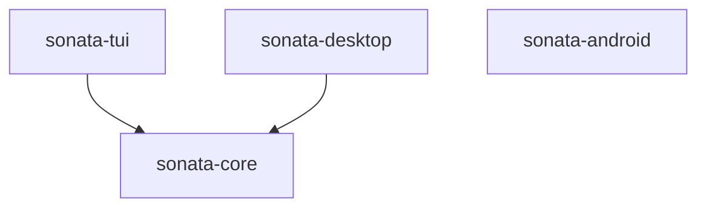
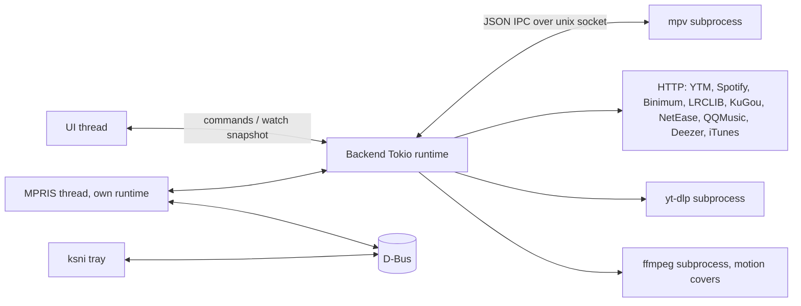

# Sonata Architecture

Sonata is a 4-crate Cargo workspace: one shared engine crate (`sonata-core`), two desktop/terminal clients (`sonata-tui` and `sonata-desktop`), and a reserved Android placeholder (`sonata-android`). All provider access, playback, caching, artwork enrichment, and lyrics logic lives in `sonata-core`; frontends own only presentation and their own event loops.

## 1. Workspace crate map

| Crate | Kind | Role | Status |
|---|---|---|---|
| [`sonata-core`](../crates/sonata-core) | library | Auth, providers, mpv player, cache, lyrics, themes, config, artwork enrichment, `now_playing.json` export | stable |
| [`sonata-tui`](../crates/sonata-tui) | binary `sonata` | ratatui/crossterm terminal client (`src/app/{mod,state,playback,library}.rs`) | stable |
| [`sonata-desktop`](../crates/sonata-desktop) | binary `sonata-desktop` | GPUI native Wayland/Hyprland client (`src/backend/`, `src/views/{root,fullscreen,fullscreen_fx}/`) with tray and MPRIS2 | experimental |
| [`sonata-android`](../crates/sonata-android) | library | Reserved placeholder crate | placeholder |

All four are workspace members (`Cargo.toml`). `sonata-tui` and `sonata-desktop` are `default-members`.

### Dependency boundaries

- Frontends depend on `sonata-core` by path; `sonata-core` never depends on a frontend.
- `sonata-core` has no UI dependencies. UI crates (`ratatui`, `gpui-kit`, `cosmic-text`, `ksni`, `mpris-server`) are confined to their respective frontends.
- `sonata-android` has no dependencies.

### Inside `sonata-core`

| Module | Responsibility |
|---|---|
| `auth/cookies.rs` | Browser cookie extraction (`0o600`/`0o700`), `SAPISIDHASH`, Spotify `sp_dc` |
| `providers/ytmusic/{mod,parsers}.rs` | InnerTube client & JSON tree parsers: library, home, artist, search, likes, playlist edits, native lyrics |
| `providers/spotify/{mod,embed}.rs` | Spotify web-player GraphQL client plus keyless embed-page playlist parsing |
| `providers/hifi.rs`, `providers/hifi/*` | `StreamResolver`: fast stream, Hi-Fi upgrade, recovery; `innertube`, `ytdlp`, `cache`, `matching` helpers |
| `player/mpv.rs` | `mpv` subprocess control over JSON IPC |
| `player/coordinator.rs`, `tasks.rs`, `precache.rs` | Playback command/transition rules, abortable task sets, next-track precache state machine |
| `cache.rs`, `cache/media.rs` | SQLite record cache with poison recovery; byte-budget pruning of art/audio/lyrics files |
| `lyrics/{mod,lrclib,providers,ttml}.rs` | LRC/TTML/KRC/YRC parsing and multi-source lyric fetching |
| `media.rs` | Enriched `now_playing.json` export, `upscale_artwork_url`, Deezer/iTunes cover resolution, Apple Music animated motion cover extraction (`ffmpeg`) |
| `config.rs`, `theme.rs` | TOML config, built-in and user themes |
| `hyprland.rs` | `hyprctl --batch` opacity IPC, ancestor-PID / focused-terminal & desktop window discovery |
| `redaction.rs`, `telemetry.rs` | Log scrubbing (cookies, auth headers, signed URLs) and tracing setup |

## 2. Runtime process and threading model

**TUI** (`sonata-tui`): a single Tokio runtime drives the ratatui event loop; background work posts `AppEvent`s over an unbounded channel to `App::handle_app_event` (`src/app/mod.rs`). `mpv` events arrive on the same channel.

**Desktop** (`sonata-desktop`):

1. **UI thread**: GPUI main thread embeds `Inter` fonts (`src/main.rs`) and renders `SonataDesktopView` from an `Arc<DesktopSnapshot>`.
2. **Backend thread**: `spawn_backend` (`src/backend/mod.rs`) starts a dedicated multi-thread Tokio runtime hosting `BackendEngine`. It receives `BackendCmd`s, a 40 ms smooth-tick (`backend/mod.rs:343`), `mpv` events and internal task results, then publishes a new snapshot through a `tokio::sync::watch` channel.
3. **mpv**: external process, controlled by JSON IPC over a unix socket named `sonata-mpv-<pid>.sock` (in `$XDG_RUNTIME_DIR`, else the cache dir).
4. **MPRIS2**: `integrations/mpris.rs` runs `mpris-server` on its own thread with a current-thread runtime.
5. **Tray**: `integrations/tray.rs` uses `ksni` (StatusNotifierItem over D-Bus), spawned from the backend.
6. **Signal watcher**: a separate thread/runtime in `main.rs` translates `SIGTERM`/`SIGINT` to window commands.

Stale-result protection: the engine tags work with monotonically increasing sequence numbers (`play_seq`, request ids) and drops results that arrive for a superseded request.

## 3. Shared filesystem layout

Paths come from `dirs` (`config.rs`), so `~/.config` and `~/.cache` follow XDG overrides.

| Path | Content |
|---|---|
| `~/.config/sonata/config.toml` | User settings |
| `~/.config/sonata/themes/*.toml` | Custom themes (an `example-custom.toml` is seeded) |
| `~/.cache/sonata/sonata_cache.db` | SQLite (WAL) record cache |
| `~/.cache/sonata/lyrics/` | Cached `.lrc` (including Enhanced LRC `<mm:ss.xxx>` + `v2:`), `.txt`, and `.wordcheck` markers |
| `~/.cache/sonata/art/` | Cover art |
| `~/.cache/sonata/audio/` | Precached/upgraded audio files |
| `~/.cache/sonata/yt_cookies.txt`, `cookies_<browser>.txt` | Extracted browser cookies (`0o600` Netscape format) |
| `$XDG_RUNTIME_DIR/sonata/now_playing.json` | Atomically written now-playing export (falls back to the cache dir) |

The art, audio and lyrics directories share one byte budget (`cache_limit_gb`, default 1, max 10), enforced by `cache/media.rs`.
