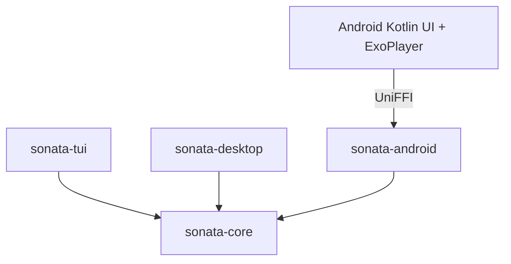
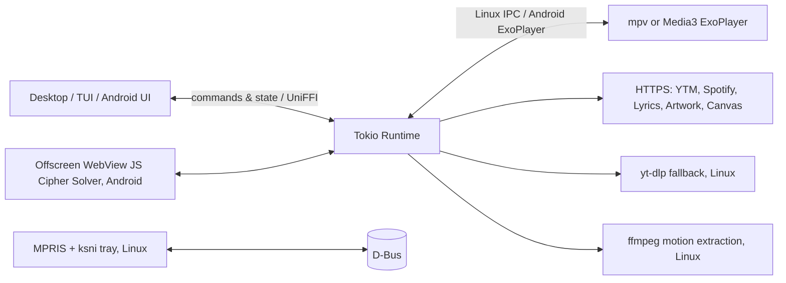

# Sonata Architecture

Sonata is a 4-crate Cargo workspace paired with a native Android Jetpack Compose application: one shared Rust engine (`sonata-core`), two Linux clients (`sonata-tui` and `sonata-desktop`), and the UniFFI Android bridge (`sonata-android`) backing `android/`. Shared provider access, playback state rules, SQLite/media caching, artwork enrichment, updater filtering, and lyrics logic live in `sonata-core`; frontends own presentation, platform audio engines, and event loops.

## 1. Workspace & Client Map

| Component | Kind | Role | Status |
|---|---|---|---|
| [`sonata-core`](../crates/sonata-core) | Rust library | Auth, YTM/Spotify providers, Hi-Fi `StreamResolver` & cipher hook, `mpv` IPC, SQLite WAL cache, lyrics, `motion.rs`, `updater.rs`, `redaction.rs` | stable |
| [`sonata-tui`](../crates/sonata-tui) | Binary `sonata` | Ratatui/crossterm terminal client (`src/app/{mod,state,playback,library}.rs`) with Kitty/Sixel/Halfblock artwork | stable |
| [`sonata-desktop`](../crates/sonata-desktop) | Binary `sonata-desktop` | GPUI native Wayland/Hyprland client (`src/backend/`, `src/views/{root,fullscreen,fullscreen_fx}/`) with tray and MPRIS2 | active |
| [`sonata-android`](../crates/sonata-android) | UniFFI library | Rust-to-Kotlin FFI bridge (`SonataAndroidEngine` + Tokio runtime + SQLite cache + `report_playback`) | stable |
| [`android/`](../android) | Android app | Jetpack Compose + Media3 ExoPlayer client (`Violet` & `Moonflower` themes, Liquid Glass chrome, Share Sheet, Widget) | stable |

All four Rust crates are workspace members in [Cargo.toml](../Cargo.toml). `sonata-tui` and `sonata-desktop` are `default-members`.

### Dependency Boundaries

- Frontends and `sonata-android` depend on `sonata-core` by path; `sonata-core` never depends on any frontend.
- `sonata-core` has no UI dependencies (`ratatui`, `crossterm`, `gpui-kit`, `cosmic-text`, `ksni`, `mpris-server` stay in desktop/TUI crates; `uniffi` stays in `sonata-android`).

### Inside `sonata-core`

| Module | Responsibility |
|---|---|
| `auth/cookies.rs` | Browser cookie extraction (`0o600`/`0o700`), `SAPISIDHASH`, Spotify `sp_dc`, Android cookie persistence (`set_android_dirs`) |
| `providers/ytmusic/{mod,parsers}.rs` | InnerTube client & JSON tree parsers: library, home, radio mixes, artist pages, search, `FEmusic_history`, likes, playlist edits, `report_playback` |
| `providers/spotify/{mod,embed}.rs` | Spotify web-player GraphQL client plus keyless embed-page playlist parsing |
| `providers/hifi.rs`, `providers/hifi/*` | `StreamResolver`: fast stream, `TVHTML5` (`itag=774`/`141`) zero-AST `base.js` cipher hook, Hi-Fi upgrade, recovery; `innertube`, `ytdlp`, `cache`, `matching` |
| `player/mpv.rs` | `mpv` subprocess control over JSON IPC |
| `player/coordinator.rs`, `tasks.rs`, `precache.rs` | Playback command/transition rules, abortable task sets, next-track precache state machine |
| `cache.rs`, `cache/media.rs` | SQLite WAL record cache with poison recovery; byte-budget pruning of art/audio/lyrics files |
| `lyrics/{mod,lrclib,providers,ttml}.rs` | LRC/TTML/KRC/YRC parsing and concurrent multi-source word-synced lyric fetching |
| `media.rs`, `motion.rs` | Enriched `now_playing.json` export, `upscale_artwork_url`, Deezer/iTunes cover resolution, Apple Music HLS motion covers (`ffmpeg` / 768x768 variants) |
| `config.rs`, `theme.rs`, `hyprland.rs` | TOML config, desktop themes, `hyprctl --batch` opacity IPC |
| `redaction.rs`, `telemetry.rs`, `updater.rs` | Log scrubbing (cookies, auth headers, signed URLs), tracing setup, per-platform GitHub Releases updater |

## 2. Runtime Process & Threading Model

- **TUI** (`sonata-tui`): Single Tokio runtime drives the ratatui event loop (`src/app/mod.rs`) and receives `mpv` IPC events + `YtMusicClient::report_playback` updates.
- **Desktop** (`sonata-desktop`): GPUI UI thread renders `Arc<DesktopSnapshot>` from a dedicated Tokio backend (`src/backend/`) while separate MPRIS2 and `ksni` tray integrations bind to session D-Bus.
- **Android** (`android/` + `sonata-android`): `SonataViewModel` orchestrates UI state (`StateFlow`), `PlaybackService` (Media3 ExoPlayer foreground session), offscreen WebView `AndroidJsCipherSolver` callback bridge, `DownloadManager`, `CanvasResolver`, `JioSaavnSource`, and `SonataAndroidEngine` (`crates/sonata-android/src/lib.rs`).

## 3. Shared Filesystem Layout

Paths resolve via `dirs` on Linux (`config.rs`) or Android's private `filesDir`/`cacheDir` registered via `AppConfig::set_android_dirs` (`0o700` dir, `0o600` files):

| Path | Content |
|---|---|
| `~/.config/sonata/config.toml` | Linux user settings |
| `~/.config/sonata/themes/*.toml` | Custom Linux desktop/TUI themes |
| `<files>/sonata/ytm_session.cookie` | Private Android WebView YTM session cookie (`0o600`) |
| `<cache>/sonata/sonata_cache.db` | SQLite (WAL) record & lyrics/stream cache |
| `<cache>/sonata/lyrics/`, `art/`, `audio/` | Cached lyrics, covers, and prefetched audio bounded by `cache_limit_gb` |
| `~/.cache/sonata/yt_cookies.txt` | Extracted Linux browser cookies (`0o600` Netscape format) |
| `$XDG_RUNTIME_DIR/sonata/now_playing.json` | Atomically written Linux now-playing export |
