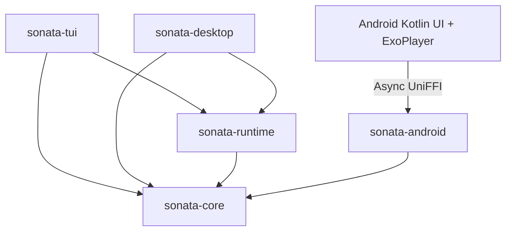
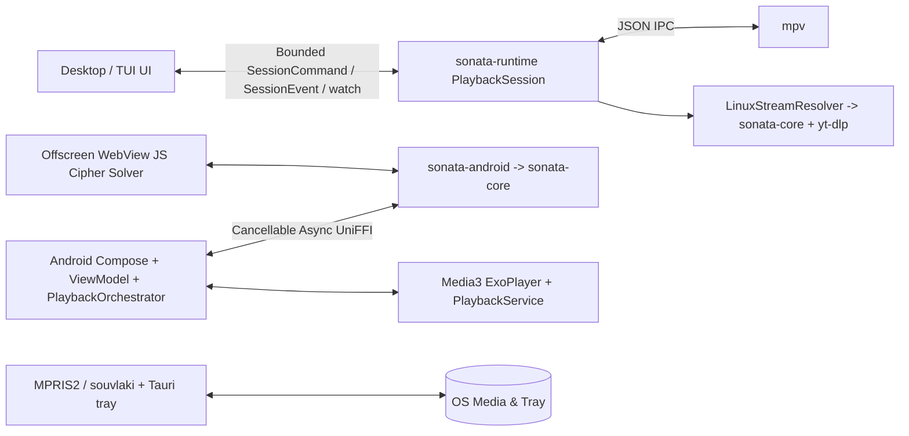

# Sonata Architecture

Sonata is a 5-crate Cargo workspace paired with a native Android Jetpack Compose application: a portable Rust engine (`sonata-core`), a shared desktop/TUI runtime adapter crate (`sonata-runtime`), two desktop/terminal clients (`sonata-tui` and cross-platform Tauri v2 `sonata-desktop`), and a cancellable async UniFFI Android bridge (`sonata-android`) backing `android/`.

## 1. Workspace & Client Map

| Component | Kind | Role | Status |
|---|---|---|---|
| [`sonata-core`](../crates/sonata-core) | Rust library | Portable auth/cookies, YTM/Spotify/JioSaavn providers, `ResolverProfile`, Hi-Fi `StreamResolver` & cipher hook, SQLite WAL cache, lyrics, `MotionMedia` discovery, `PlaybackCoordinator`, `CorePaths`, `CoreError`, `redaction`, `updater` | stable |
| [`sonata-runtime`](../crates/sonata-runtime) | Rust library | Shared desktop/TUI runtime adapters (Linux, macOS, Windows): XDG TOML `AppConfig`, Hyprland IPC, tracing/log rotation, `i18n` (`en`/`tr`/`ru`), browser cookie extraction, `MpvController`, shared `PlaybackSession`, `CliJsCipherBridge`, `LinuxStreamResolver` (`yt-dlp`), image/`ffmpeg` decoding, `now_playing.json` | stable |
| [`sonata-tui`](../crates/sonata-tui) | Binary `sonata` | Ratatui/crossterm terminal client (`src/app/{mod,state,playback,library}.rs`, `src/ui/fx.rs` `tachyonfx` transitions, `src/theme/`) with Kitty/Sixel/Halfblock artwork | stable |
| [`sonata-desktop`](../crates/sonata-desktop) + [`desktop-ui/`](../desktop-ui) | Binary `sonata-desktop` | Cross-platform Tauri v2 desktop client (`src/backend/`, `src/ipc.rs`, `src/integrations/{mpris,tray}.rs`, `desktop-ui/` React 19 + Tailwind CSS v4 + shadcn/ui matte obsidian UI) with system tray, `sonata:motionArtUrl` MPRIS2, and `souvlaki` media controls | stable |
| [`sonata-android`](../crates/sonata-android) | UniFFI library | Cancellable async Rust-to-Kotlin FFI bridge (`#[uniffi::export(async_runtime = "tokio")]`, zero `Runtime::block_on`) | stable |
| [`android/`](../android) | Android app | Jetpack Compose + Media3 ExoPlayer client (`SonataEngineGateway`, `PlaybackOrchestrator`, `Basic` [default], `Violet` & `Moonflower` themes, neutral Liquid Glass chrome, `en`/`tr`/`ru` `SonataStrings`, `EditPlaylistDialog`, `ApkUpdater`, Share Sheet, Widget) | stable |

All five Rust crates are workspace members in [Cargo.toml](../Cargo.toml). `sonata-tui` and `sonata-desktop` are `default-members`.

### Dependency Boundaries

- `sonata-core` has zero UI, subprocess, browser-reader, image-decoding, or Linux-desktop dependencies and never branches on `cfg!(target_os = "android")` inside provider logic (platform behavior is configured explicitly via `ResolverProfile` and `CorePaths`).
- `sonata-android` depends strictly on `sonata-core` (never `sonata-runtime`, `image`, `dirs`, `toml`, or `tracing-appender`).
- Dependency direction and forbidden imports are enforced automatically in CI by [scripts/check_boundaries.sh](../scripts/check_boundaries.sh).

### Inside `sonata-core`

| Module | Responsibility |
|---|---|
| `paths.rs`, `error.rs` | Instance-scoped `CorePaths` (no global path statics) and typed redacted `CoreError` |
| `auth/cookies.rs` | Portable Netscape/header cookie parsing, `SAPISIDHASH`, Spotify `sp_dc`, and atomic `0o600`/`0o700` session storage |
| `providers/ytmusic/{mod,parsers,browse,album,search}.rs` | InnerTube client & split pure parsers: library, home + mood chips, explore + mood tiles, radio mixes, artist pages & banners, album details, search suggestions & rich typed search, `FEmusic_history`, likes/dislikes, playlist metadata editing & custom cover upload (`ACTION_SET_CUSTOM_THUMBNAIL`), `report_playback` |
| `providers/spotify/{mod,embed}.rs` | Spotify web-player GraphQL client plus keyless embed-page playlist parsing |
| `providers/jiosaavn.rs` | Pure-Rust DES-ECB JioSaavn decryptor, catalog search, strict metadata matching, and typed upgrade selection (shared across Linux and Android) |
| `providers/profile.rs`, `providers/hifi.rs`, `providers/hifi/*` | Explicit `ResolverProfile`, `StreamResolver`, `TVHTML5` (`itag=774`/`141`) zero-AST `base.js` cipher hook, Hi-Fi upgrades, recovery, and bounded prefetching |
| `player/{mod,coordinator,tasks,precache}.rs` | Pure `PlaybackState`, `PlaybackGeneration`, `PlaybackCoordinator`, `PlaybackTaskSet`, and `NextTrackPrecache` |
| `cache.rs`, `cache/media.rs` | SQLite WAL record cache with poison recovery; byte-budget pruning of art/audio/lyrics files |
| `lyrics/{mod,lrclib,providers,ttml}.rs` | LRC/TTML/KRC/YRC parsing and concurrent multi-source word-synced lyric fetching |
| `media.rs`, `motion.rs` | Typed `now_playing.json` &amp; `lyrics.json` telemetry schemas, artwork URL upscaling, Deezer/iTunes cover lookup, and platform-neutral `MotionMedia` discovery (Apple Music AMP/HTML, Tidal, Community Canvas) |
| `redaction.rs`, `updater.rs` | Secret scrubbing (cookies, auth headers, signed URLs, nested JSON) and per-platform GitHub Releases updater |

### Inside `sonata-runtime`

| Module | Responsibility |
|---|---|
| `config.rs`, `hyprland.rs`, `telemetry.rs`, `i18n.rs` | XDG TOML `AppConfig`, Hyprland opacity IPC, rotating `sonata.log`, and `en`/`tr`/`ru` `UiStrings` catalog |
| `auth/browser.rs` | Linux browser cookie discovery & extraction |
| `player/{mpv.rs,session.rs}` | Headless `mpv` JSON-IPC driver and shared `PlaybackSession` actor with bounded non-dropping command/event channels, coalesced `PlaybackProgress`, per-generation cancellation, recovery budget, upgrade swap/fallback, and precache adoption |
| `process/{cipher.rs,ytdlp.rs}` | `CliJsCipherBridge` and `LinuxStreamResolver` (`yt-dlp` fast-start race, recovery, `kill_on_drop`, `0o600` temp cookie copies) |
| `media/{mod.rs,motion.rs}` | Cover image decoding/pillarbox trimming, ambient color extraction, atomic `now_playing.json` writes, and `ffmpeg` motion-cover frame decoding |

## 2. Runtime Process & Threading Model

- **TUI** (`sonata-tui`) and **Desktop** (`sonata-desktop`): Delegate all playback orchestration (queue transitions, generation isolation, `mpv` IPC, Hi-Fi upgrades, recovery, and next-track precaching) to `sonata_runtime::player::PlaybackSession`, retaining client-local UI, graphics/effects, MPRIS2/tray, and per-generation cover/lyrics tasks (`media_tasks`).
- **Android** (`android/` + `sonata-android`): `SonataViewModel` delegates all native operations through `SonataEngineGateway` (backed by cancellable `suspend` UniFFI Tokio futures with zero `Runtime::block_on`), enforces single-generation playback orchestration via `PlaybackOrchestrator`, and retains Media3 ExoPlayer, `PlaybackService`, `DownloadManager`, and platform-local `CanvasResolver` caching in Kotlin.

## 3. Shared Filesystem Layout

Paths are constructed explicitly via `CorePaths` (XDG roots from `sonata-runtime::config::AppConfig` on Linux, or Android's private `filesDir`/`cacheDir` passed into `SonataAndroidEngine::new`):

| Path | Content |
|---|---|
| `~/.config/sonata/config.toml` | Linux user settings |
| `~/.config/sonata/themes/*.toml` | Custom Linux TUI themes |
| `<files>/sonata/ytm_session.cookie` | Private Android WebView YTM session cookie (`0o600`) |
| `<cache>/sonata/sonata_cache.db` | SQLite (WAL) record & lyrics/stream cache |
| `<cache>/sonata/lyrics/`, `art/`, `audio/` | Cached lyrics, covers, and prefetched audio bounded by cache limit |
| `~/.cache/sonata/yt_cookies.txt` | Extracted Linux browser cookies (`0o600` Netscape format) |
| `~/.cache/sonata/sonata.log` | Linux Desktop/runtime diagnostics log (`10 MiB` startup cap, `0o600`) |
| `~/.cache/sonata/sonata-tui.log` | Linux TUI stderr diagnostics redirect (`2 MiB` startup cap) |
| `<cache>/updates/` | Android in-app APK updater staging directory (`ApkUpdater.kt` + `FileProvider`) |
| `$XDG_RUNTIME_DIR/sonata/now_playing.json` | Atomically written structured Linux now-playing telemetry (`schema_version = 2`; see [integrations.md](integrations.md)) |
| `$XDG_RUNTIME_DIR/sonata/lyrics.json` | Atomically written full synced/translated/romanized lyrics sheet (see [integrations.md](integrations.md)) |
